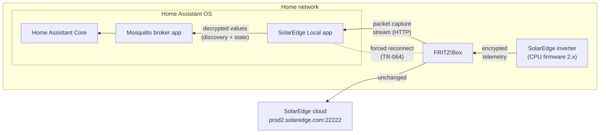

# SolarEdge Local for Home Assistant

Home Assistant add-on that reads inverter and optimizer data from older SolarEdge inverters
**locally**, without the SolarEdge cloud API, and publishes it to Home Assistant via MQTT.

It is meant for inverters with old firmware (CPU 2.x) that don't support SunSpec/Modbus.
It uses a FRITZ!Box packet capture of the inverter's own traffic and decrypts it with the inverter's key.

**Status:** work in progress. A working prototype is in `prototype/`.

## How it works

The inverter keeps talking to the SolarEdge cloud as before. The app only listens: it captures the
inverter's traffic on the FRITZ!Box, decrypts it with the inverter's key and publishes the values over MQTT.

## Requirements
- SolarEdge inverter connected by LAN, behind a FRITZ!Box
- The inverter's encryption key (read once over RS232, see `prototype/get_key_rs232_timeout.py`)
- Home Assistant OS with the Mosquitto broker add-on

## Installation
1. Home Assistant → Settings → Apps → App store → ⋮ → Repositories → add
   `https://github.com/huer12/ha-addon-solaredge-legacy`.
2. Install **SolarEdge Local**, fill in the options on the Configuration tab, start it.

See [solaredge_local/DOCS.md](solaredge_local/DOCS.md) for the options and entities.

## Development
```powershell
py -m venv .venv
.\.venv\Scripts\python -m pip install -r solaredge_local\requirements.txt pytest pytest-asyncio
.\.venv\Scripts\python -m pytest
```

Decode a saved capture offline:
```powershell
$env:SE_KEY = '<32-hex-key>'
cd solaredge_local; ..\.venv\Scripts\python -m app.main --replay ..\captures\test.eth
```

Run live on Windows against the FRITZ!Box and a Mosquitto broker: put the options as JSON into
`options.local.json` (same keys as on the Configuration tab, ignored by git), then:
```powershell
$env:MQTT_HOST = 'homeassistant.local'; $env:MQTT_USER = '<user>'; $env:MQTT_PASSWORD = '<password>'
cd solaredge_local; ..\.venv\Scripts\python -m app.main --options ..\options.local.json --data-dir ..\.localdata
```

## Credits
- [se-logger](https://github.com/Jerrythafast/se-logger) – decryption and telemetry parsing (GPLv3)
- [jbuehl/solaredge](https://github.com/jbuehl/solaredge) – protocol reverse engineering
- [fritzdump](https://github.com/arn-c0de/fritzdump) – FRITZ!Box capture approach

## License
GPLv3 (because it builds on se-logger).
